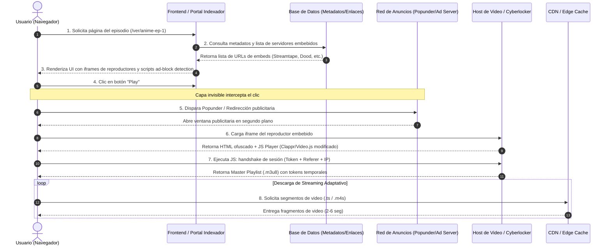

# Arquitectura e Infraestructura Técnica de Plataformas de Streaming Gratuito

Este documento desglosa exhaustivamente los componentes de software, ingeniería de redes, modelos de distribución de datos y mecanismos operativos utilizados por las plataformas de streaming no oficial (anime, películas y series).

---

## 1. Arquitectura General y Flujo de Datos

Las plataformas de streaming gratuito operan bajo un modelo estrictamente desacoplado. El sitio web principal (portal indexador) casi nunca almacena ni distribuye video directamente; su función es actuar como capa de presentación, orquestador de publicidad y agregador de enlaces a reproductores embebidos alojados en proveedores externos.

### Diagrama de Secuencia del Flujo de Reproducción



---

## 2. Ingesta y Agregación de Contenido

### 2.1 Desacoplamiento Legal y Operativo
El principio arquitectónico fundamental es la separación entre el **agregador** y el **almacén**:
- El portal frontend aloja únicamente metadatos (título, sinopsis, miniaturas, etiquetas) y referencias abstractas a IDs de video en plataformas de terceros (*cyberlockers*).
- Esta división reduce costos de almacenamiento casi a cero en el servidor del portal y traslada los requisitos de ancho de banda a los hosts de video.

### 2.2 Pipeline de Automatización (Crawlers y Scrapers)
1. **Detección de Estrenos**:
   - Daemons en segundo plano monitorean fuentes primarias (trackers de BitTorrent privados/públicos, feeds RSS de fansubs, servicios oficiales con protecciones débiles o grupos de ripeo).
   - Herramientas: Scripts en Python (Scrapy, Playwright/Puppeteer con bypass de Cloudflare mediante FlareSolverr).
2. **Descarga y Reenvío Remoto (*Remote Upload*)**:
   - Para no saturar el servidor local, los scripts aprovechan las APIs de *Remote Upload* que ofrecen los cyberlockers.
   - Se envía la URL fuente directamente a la API del file-host, transfiriendo el archivo de servidor a servidor sin pasar por el ancho de banda del portal.
3. **Normalización de Metadatos**:
   - Mapeo automatizado contra APIs públicas (AniList, MyAnimeList, TMDB, TVMaze) mediante similitud de cadenas (Levenshtein distance) para indexar número de temporada, episodio e imagen de portada.
4. **Almacenamiento de Enlaces**:
   - Bases de datos relacionales (PostgreSQL/MySQL) o documentos (MongoDB) con esquemas estructurados:
     ```json
     {
       "content_id": "shingeki-s4-ep1",
       "servers": [
         {"name": "Streamtape", "embed_id": "abc123xyz", "priority": 1},
         {"name": "Doodstream", "embed_id": "d00d456", "priority": 2},
         {"name": "Fembed", "embed_id": "fem789", "priority": 3}
       ]
     }
     ```

---

## 3. Almacenamiento y Distribución de Video

### 3.1 El Ecosistema de Cyberlockers
Los servidores de video (Streamtape, Doodstream, Mixdrop, Streamwish, Filemoon) operan como plataformas de hosting comercializadas bajo esquemas PPD/PPS (*Pay Per Download* / *Pay Per Stream*):
- Pagan al uploader (el administrador del portal) una fracción de céntimo por cada mil reproducciones completas.
- El cyberlocker monetiza directamente insertando sus propios anuncios dentro del reproductor antes de entregar el flujo de video.

### 3.2 Transcodificación y Segmentación
Cuando un video sube al host:
1. **Transcodificación Distribuida**: Workers con FFmpeg convierten el archivo crudo (MKV/MP4) a perfiles adaptativos (360p, 480p, 720p, 1080p) con códec de video H.264 (AVC) y audio AAC para máxima compatibilidad con navegadores sin plugins.
2. **Fragmentación HLS (HTTP Live Streaming)**:
   - El video se parte en pequeños trozos (`.ts` o fragmentos `.m4s`) de 2 a 6 segundos.
   - Se genera una lista de reproducción principal (`master.m3u8`) que referencia listas secundarias por resolución (`720p.m3u8`, `1080p.m3u8`).
3. **Ventajas Técnicas de HLS**:
   - Permite que el reproductor ajuste la calidad en tiempo real según el ancho de banda disponible del usuario.
   - Hace inviable la descarga directa con un clic derecho tradicional, requiriendo software especializado para reconstruir los segmentos.

### 3.3 Redes de Distribución y Proxies Edge
- **Servidores de Video Offshore**: Servidores dedicados en centros de datos con políticas de copyright laxas o tiempos de respuesta lentos a reclamos legales (Rusia, Países Bajos, Rumania, Moldavia).
- **Reverse Proxies y CDNs Intermedias**:
  - Servidores Nginx o Envoy actuando como proxies de caché para los fragmentos estáticos `.ts`.
  - Enrutamiento detrás de Cloudflare usando dominios desechables para mitigar ataques DDoS y enmascarar las direcciones IP de origen del backend.

---

## 4. Mecanismos de Embed y Desofuscación

### 4.1 Arquitectura del Iframe Embebido
El portal renderiza un elemento `<iframe>` que carga la página del reproductor del host externo:
```html
<iframe src="https://stream-host-domain.com/e/abc123xyz" frameborder="0" allowfullscreen allow="autoplay"></iframe>
```
Dentro de este iframe, el proveedor externo ejecuta su propia pila web:
- Reproductor de video en JavaScript (generalmente forks de Video.js, Clappr, JWPlayer o Plyr).
- Scripts de telemetría, contadores de reproducciones y trackers de publicidad.

### 4.2 Métodos de Ofuscación de JavaScript
Para evitar que extractores automáticos (`yt-dlp`, extensiones de navegador) obtengan la URL del archivo de video sin ver la publicidad:
1. **Dean Edwards Packer**:
   - Código envuelto en la conocida firma: `eval(function(p,a,c,k,e,d)...)`.
   - Se decodifica en tiempo de ejecución reconstruyendo un diccionario de palabras y sustituyendo índices en base 36 o 62.
2. **Transformaciones AST y Control Flow Flattening**:
   - Sustitución de cadenas literales por arreglos en hexadecimal (`_0x4f2a = ['\x68\x74\x74\x70', ...]`).
   - Aplanamiento del flujo de control: bucles `while` infinitos con declaraciones `switch` que alteran el orden natural del código.
   - Inyección de código muerto (*dead code injection*) y verificaciones anti-depuración (`debugger;` en intervalos periódicos para colgar las DevTools del navegador).
3. **Cálculo Dinámico de Tokens**:
   - El reproductor ejecuta una función matemática con datos volátiles: `MD5(ip_usuario + expiracion + clave_secreta_servidor + user_agent)`.
   - La URL del `.m3u8` devuelta solo es válida por 30-120 segundos y expira al consumirse los fragmentos.

### 4.3 Validación de Headers y Anti-Hotlinking
El servidor del stream valida estrictamente los encabezados HTTP de cada petición entrante:
- **`Referer` y `Origin`**: Deben coincidir con el dominio del reproductor embebido; solicitudes directas sin referer son rechazadas con error HTTP 403 Forbidden.
- **`Sec-Fetch-Site` y `Sec-Fetch-Mode`**: Validados en navegadores modernos para confirmar que la llamada proviene de un contexto multimedia legítimo.

---

## 5. Seguridad, Evasión y Resiliencia

### 5.1 Rotación de Dominios y Arquitectura de Respaldo
Las plataformas de streaming implementan una topología de dominios jerárquica para sobrevivir a bloqueos DNS y órdenes judiciales:

```
[ Dominio Primario / Marca ] (anime-brand.com) 
        │ (Redirección 301 / Cloudflare Worker)
        ▼
[ Dominio Activo de Servicio ] (anime-brand.to / .pe / .ru)
   ├── frontend.anime-brand.to (UI pública)
   ├── api.anime-brand-backend.net (Endpoints JSON privados)
   └── cdn.anime-brand-assets.com (Imágenes, CSS, scripts locales)
```

1. **Separación de Capas**: El dominio donde el usuario navega nunca coincide con el dominio que sirve las APIs ni con el que aloja los reproductores. Si un ISP bloquea el dominio principal, solo se actualiza la redirección DNS hacia un nuevo TLD (.cc, .io, .tv).
2. **Uso de DoH (DNS over HTTPS)**: Mensajes en el portal instruyen a los usuarios a activar DNS de Cloudflare (`1.1.1.1`) o Google (`8.8.8.8`) en sus navegadores para eludir bloqueos locales a nivel de ISP.

### 5.2 Protección contra Bots y Scrapers de la Competencia
Los portales implementan defensas para que otros sitios no "roben" sus listas de enlaces indexados:
- **Cloudflare Bot Management / Turnstile**: Desafíos CAPTCHA transparentes basados en análisis de comportamiento y comprobación de firma TLS (JA3/JA4 fingerprints).
- **Rate Limiting Agresivo**: Limitación por IP mediante token buckets en Nginx o reglas de borde en WAF.
- **Respuestas Mock/Honeytokens**: Respuestas falsas con enlaces inservibles cuando detectan clientes automatizados sin cabeceras de navegador real.

---

## 6. Ecosistema de Monetización

Dado que las redes publicitarias convencionales (Google AdSense, Media.net) prohíben sitios con contenido sin licencia, estas plataformas recurren a redes publicitarias secundarias especializadas (PropellerAds, Adsterra, ExoClick, PopAds, HilltopAds).

### 6.1 Formatos Publicitarios y Mecanismos de Disparo
1. **Popunders (Ventanas Subterráneas)**:
   - Una capa invisible (`<div>` transparente que cubre toda la pantalla o el área del reproductor) intercepta el primer clic del usuario.
   - El script abre una nueva pestaña o ventana con el anunciante y la envía al fondo del sistema operativo (`window.blur()` o enfoque forzado a la ventana original).
   - Inmediatamente después del primer clic, el div invisible se destruye en el DOM, permitiendo que el segundo clic interactúe normalmente con el reproductor.
2. **Interstitials y Redirecciones Temporales**:
   - Enlaces intermedios con contadores regresivos de 5 a 15 segundos antes de redirigir al enlace final.
3. **Notificaciones Push y Engaño de Ingeniería Social**:
   - Avisos simulados ("Su reproductor está desactualizado", "Detectado virus", "Presione Permitir para verificar que no es un robot") diseñados para suscribir al usuario a servicios de mensajería spam o descargas de adware.

### 6.2 Batalla Anti-Adblock
- **Detección**:
  - Inserción de elementos señuelo con clases comúnmente bloqueadas (`<div class="ad-banner adsbox"></div>`). Si el cliente tiene uBlock Origin o AdBlock, estos elementos tendrán altura 0 o `display: none`.
  - Carga de archivos JS señuelo (`ads.js`, `prebid.js`). Si fallan al cargar (`net::ERR_BLOCKED_BY_CLIENT`), se dispara el banner que bloquea el contenido hasta desactivar la extensión.
- **Bypass de Bloqueadores por parte del Sitio**:
  - Reempaquetado de scripts publicitarios: Servir el código publicitario desde el propio dominio del portal a través de URLs dinámicas que cambian periódicamente (`/assets/script-7a8f9.js`), evitando las listas de filtros estáticas (EasyList).
  - Cifrado simétrico de las etiquetas del reproductor, desofuscándolas en memoria mediante WebAssembly para ocultar las llamadas a red de los filtros de inspección del navegador.

---

## 7. Resumen de Tecnologías Clave

| Componente | Tecnologías Habituales |
| :--- | :--- |
| **Frontend UI** | Next.js, Nuxt.js, Laravel Blade, PHP plano (optimizado con caché Redis) |
| **Automatización / Scraping** | Python, Node.js (Playwright, Puppeteer, Scrapy, FlareSolverr) |
| **Players Web** | Video.js, Clappr, JWPlayer (customizado), Plyr |
| **Streaming & Streaming Formats** | HLS (.m3u8), MPEG-DASH (.mpd), MP4 fallback |
| **Transcodificación** | FFmpeg (H.264 / AAC en perfiles escalonados 360p-1080p) |
| **Hosting de Video** | Cyberlockers de terceros (Streamtape, Doodstream, Filemoon, Mixdrop) |
| **Infraestructura de Borde** | Cloudflare WAF, Nginx Reverse Proxy, HAProxy |
| **Monetización** | PopAds, PropellerAds, Adsterra, ExoClick |
